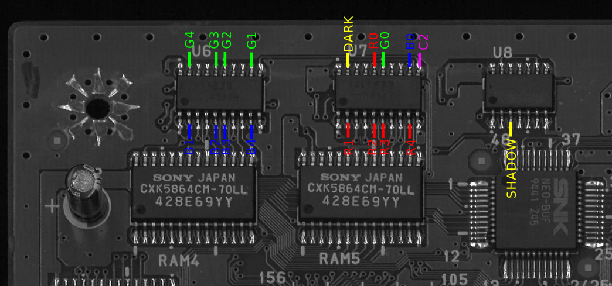
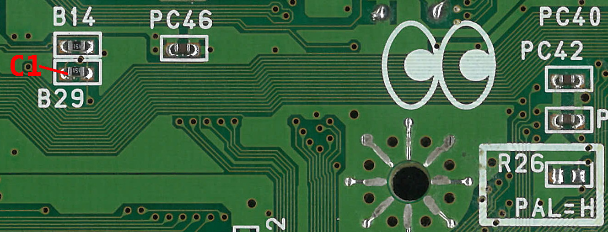
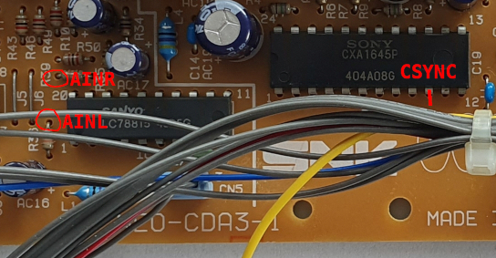
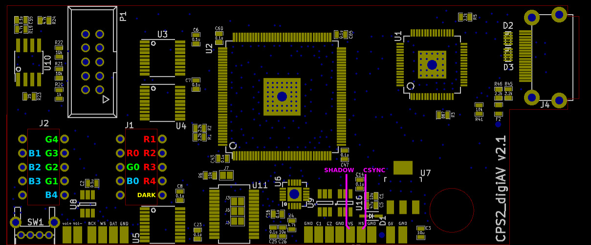
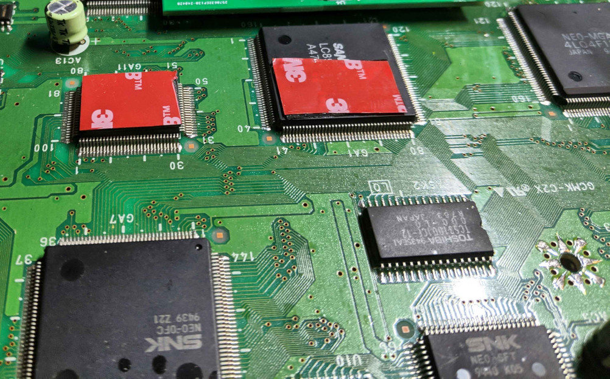
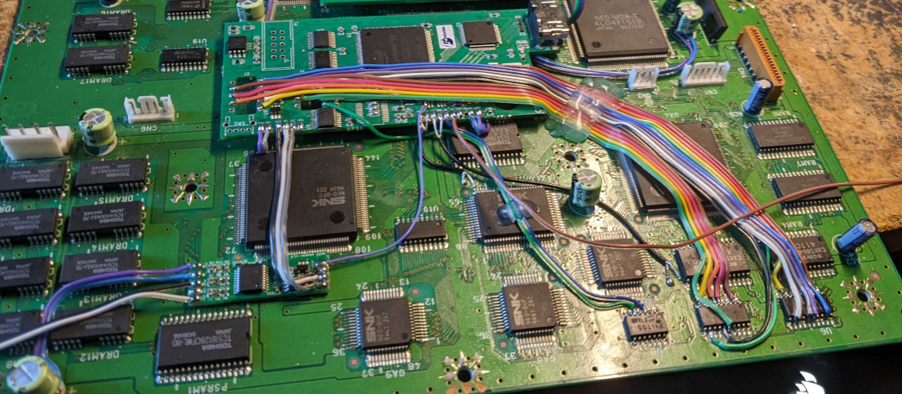
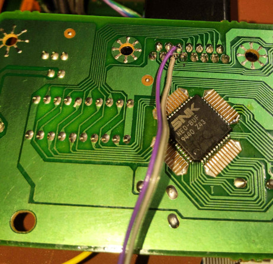

Neo Geo CD (NEO-CDM3-1 / NEO-CDM3-2) signal reference
--------------------------

[List of hookup points (CDM3-1)](./cdm3-1_hookup_points.txt)

Step 1: Preparation of cps2_digiav board
--------------------------

1. Bridge SMD jumpers J3, J5 and J6 on cps2_digiav board.

2. The board is operated via 2 keys which can be implemeted either by wiring vol-/vol+ pads to existing button lines on controller ports (e.g. P1 start & select) or by using separate buttons. In the latter case, solder R7+R8 (2x10k 0603 SMD resistors) on bottom of cps2_digiav board and connect one end of the buttons to GND and other end to vol+/- pads.

3. Cut a 10cm piece of 16 conductor ribbon cable and split in into following pieces: 5 conductor (1pcs), 4 conductor (1pcs), 3 conductor (1pcs), 1 conductor (4pcs). Strip both ends of the wires and solder them to named holes around J1/J2 footprints on cps2_digiav as shown in the picture below (solitary wires for R0, G0, B0 and B4). Cut / trim the soldered ends since they will otherwise hinder installation. Tin other ends of the wires so that they can be easily soldered on the SMD chips on CDM.

Step 2: Preparation of CDM
--------------------------

1. Make a cutout on the case for a HDMI coupler adapter like [this](https://www.amazon.com/Poyiccot-Straight-Coupler-Adapter-Connector/dp/B071LDPR8H).

2. Attach mounting tape pieces on top of GA1 and GA11 if the board is installed on the recommended location.

Step 3: Power signals
--------------------------

Connect 5V and GND points from CDM (e.g. AC1) to respective pads on cps2_digiav board with 2 short and sturdy wires.

Step 4: Clock and sync signals
--------------------------

Use short kynar wire to connect C1 from bottom of the PCB. C2 and CSYNC can be connected with kynar or similar thin wires.

Step 5: Audio signals
--------------------------

Install audio ADC board nearby with mounting tape. Hook WS, DAT and BCK signals to cps2_digiav with a 3 conductor ribbon cable etc. Connect AILR and AINR pads to CDM AV board, and 5V and GND pads to nearest suitable capacitor.

Step 6: Video signals
--------------------------

Connect 15 RGB wires from step 1 to the marked chips legs on CDM. Hook DARK and SHADOW wires similarly cps2_digiav. Note that the drawing is made for NEO-CDM3-1 and R and B buses might be swapped in other CDM revisions.

Step 7: Finalization
--------------------------

Power up and verify both audio and video works. Open cps2_digiav menu, select AES from XTAL freq option and save settings.

